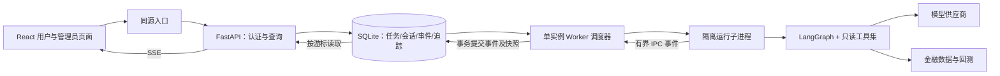

# Fin-Agent Web 问答与开发者可观测性技术方案

日期：2026-11-03。状态：需求访谈已完成；本文为实施设计，不代表功能已实现或部署。

## 1. 已确认的产品边界

- 面向少量受邀用户，在受控内网单机部署；管理员预建账号，不开放注册。
- 用户登录后只能访问自己的会话；模型及数据源密钥由服务端统一管理。
- 业务能力为查询、分析、选股、回测；禁用修改持仓、画像、配置、订阅、提醒等业务写操作。保存聊天记录属于系统基础能力，不在此禁用范围内。
- 回答真实流式显示，同时展示工具执行状态；首版不提供关闭网页后的系统通知。
- 浏览器刷新、关闭或断网后，已接受的任务继续执行；重新进入可查看结果。
- 服务执行进程重启或崩溃后，未完成运行标记中断，由用户主动重试，不承诺自动续跑。
- 同一会话最多一个排队或执行中的运行；不同会话限量并行，超限排队。
- 首版使用 LangGraph。开发者需要输入到模型及工具的完整关联、时间线和错误定位，不要求由 Harness 引擎执行。
- 管理员拥有运行列表和详情页；详细追踪默认保留 30 天；聊天保留至用户删除，删除时清理关联追踪。
- 前端采用 React + TypeScript + Vite；页面为登录、聊天、管理员运行列表、管理员运行详情。

## 2. 推荐选型与替代方案

| 层次 | 首版选择 | 优点 | 代价与替代条件 |
| --- | --- | --- | --- |
| 前端 | React + TypeScript + Vite，React Router | 静态部署，组件化，适合聊天和排障页面；类型可约束事件消费 | 路由、请求和流式状态需组织；若以后有大量公开内容和 SSR 需求，再评估 Next.js |
| UI | Ant Design；Markdown 支持 GFM 表格，禁用原始 HTML | 快速构建表单、表格和状态反馈 | 视觉定制受组件体系约束；首版不做图表编辑器 |
| API | FastAPI + Uvicorn + Pydantic | 直接复用 Python Agent；API 校验与 SSE 能力匹配 | 现有同步调用不能直接占用 ASGI 事件循环 |
| Agent | 现有 LangGraph + Web 适配层 | 已有模型文本流和金融工具，保持 CLI 能力 | 必须补齐隔离、只读策略和逐调用观测；当前 Harness 不能直接当作旁路观测器 |
| 通信 | HTTP POST 创建运行 + GET SSE 订阅 | 适合一次提交、持续下行；支持浏览器重连 | 业务层仍需事件持久化、补发和去重；需要频繁双向实时控制或语音时再评估 WebSocket |
| 数据 | SQLite WAL + SQLAlchemy + Alembic | 单机运维简单，支持事务及索引；迁移有版本记录 | 同时仅一个写者，需短事务和批量写；多机或写入竞争成为瓶颈时迁移 PostgreSQL |
| 执行 | 独立 Worker 调度进程 + 每运行一个受限子进程 | 浏览器/API 生命周期不决定任务寿命；能隔离阻塞工具和超时 | 需要 IPC、进程退出处理和运行归属校验；首版不引入 Redis/Celery |
| 部署 | 同源反向代理、API、Worker，数据持久卷 | 结构清晰，Cookie/SSE 接入简单，便于备份 | 单机故障会中断运行；首版不提供高可用 |

以上是适配本项目的判断，不是对所有应用的通用性能结论。React/Vite 的自行组合成本见 [React 文档](https://react.dev/learn/build-a-react-app-from-scratch)；FastAPI 的流式和 SSE 支持见 [流式响应](https://fastapi.tiangolo.com/advanced/custom-response/)及 [SSE 文档](https://fastapi.tiangolo.com/tutorial/server-sent-events/)。实施时必须锁定并验证依赖版本，不能假设仓库当前安装版本已经具备新文档中的全部 API。

SSE 的自动重连、事件 ID 和 Last-Event-ID 见 [HTML 标准](https://html.spec.whatwg.org/dev/server-sent-events.html)。WebSocket 提供双向通信，但本方案通过普通 HTTP 即可提交命令，首版无需自建双向消息协议，参考 [FastAPI WebSocket 文档](https://fastapi.tiangolo.com/advanced/websockets/)。

SQLite WAL 支持读写并行但仍仅一个写者，且不能把 WAL 数据库作为跨机器共享文件使用，见 [SQLite 官方说明](https://www.sqlite.org/wal.html)。数据库放本机 Docker 数据卷或本机文件系统，禁止部署在共享网络目录。

## 3. 现有代码及改造边界

| 代码位置 | 当前事实 | 设计处理 |
| --- | --- | --- |
| `fin_agent/agent/runtime.py` | 默认选择 LangGraph，也支持 Harness | Web 显式选择 LangGraph，不改 CLI 默认语义 |
| `fin_agent/agent/core.py:405` | `stream_chat()` 输出 content、thinking、tool_call、tool_result、answer、error | 映射为版本化 Web 事件；不直接透传原始事件 |
| `fin_agent/agent/core.py:87` | 在模型节点调用绑定完整工具集的模型 | 注入 Web 工具 schemas、模型回调及观测上下文 |
| `fin_agent/agent/core.py:90` | tools_node 循环执行工具 | 在每个实际执行调用的前后采集 span；模型“提出调用”不等于工具“开始执行” |
| `fin_agent/agent/core.py:506` | 在节点 updates 中发出完整调用/结果 | 不能用这些事件的接收时间倒推逐工具耗时，尤其一次提出多个工具时 |
| `fin_agent/agent/core.py:166` | 系统提示读取全局画像，并指导修改持仓、订阅和配置 | Web 注入专用提示词，禁用全局画像读取及写操作指令 |
| `fin_agent/agent/core.py:38` | 实例维护可变 history | 每运行创建隔离实例，从所属会话恢复已提交上下文，不共享单例 |
| `fin_agent/session_store.py` | 全局目录 JSON + 进程内锁，无 user_id | 新增 Web Repository；不让多人服务直接复用全局 JSON |
| `fin_agent/agent/harness.py:97` | 先等待运行，再回放工具事件及完整答案 | 首版不走此路径；以后接入须实现真正实时事件 |
| `fin_agent/agent/redaction.py` | 已有结构化字段与已配置密钥脱敏 | 作为起点；补跨片段脱敏及回归测试，不直接声称全面覆盖 |
| `fin_agent/agent/trace_query.py` | 面向 Harness 原生事件，查询时重建投影 | 复用查询概念和经过验证的纯函数；Web 直接查索引，不重建 Harness 全量索引 |

LangGraph 的 messages/custom 流式模式可作为适配参考，见 [官方流式文档源码](https://github.com/langchain-ai/docs/blob/main/src/oss/langgraph/streaming.mdx)。工具边界事件通过显式 observer/IPC 发出，不依赖节点结束后才返回的 updates。

## 4. 系统结构与执行流程



1. 登录后，前端提交问题与幂等键。API 校验归属、只读产品权限、会话活动运行及队列容量。
2. 一个短事务保存用户消息、运行记录和 queued 事件；提交成功才返回 202 和 run_id。
3. Worker 从 SQLite 领取任务，记录 owner_epoch、租约及开始时间，再启动隔离子进程。
4. 子进程加载该用户会话已提交的上下文，创建 Agent，执行模型及工具。外部调用期间不持有数据库事务。
5. Worker 接收子进程事件，进行输出过滤、脱敏和事件映射，将事件及当前消息快照事务性写入。
6. API 根据 run_id 和游标读取已提交事件，经 SSE 推送；浏览器缺席不改变执行状态。
7. 最终答案、合法的下轮模型上下文、运行终态和终态事件在同一事务提交；提交后才可显示完成。

Web API 不使用请求内生成器或 FastAPI BackgroundTasks 承担整次 Agent 运行。SSE 生成器只读持久化事件。首版用数据库短周期读取实现调度和订阅，不需要 Redis 消息总线。

初始可配置参数建议为：最多 2 个并行运行、最多 16 个排队运行、每用户最多 2 个未终止运行、数据库事件读取间隔约 100–250ms、回答片段批量写入窗口约 50–100ms。这些是待压测的起点，不是已测容量承诺。批次须有字节数上限，慢客户端不阻塞 Worker，也不能无限堆积内存。

## 5. 会话、只读策略和模型上下文

- Web 的 schemas 从经过审计的显式工具白名单生成，执行入口再次校验。同名函数、模型伪造调用或直接绕过前端均不能越过执行检查。
- 白名单按业务效果审核，不能根据函数名以 get 开头就判定安全。禁用持仓、全局画像、个人提醒及订阅读取，直到存在用户级隔离；也禁用创建订阅、刷新后台任务、邮件和配置工具。
- 行情请求的公共缓存、回测临时文件允许存在，但必须使用受控缓存或运行专属目录，不修改用户业务状态、不触发通知、不读取旧 CLI 用户的私有数据。
- 模型及数据源配置仅管理员在服务端配置，Agent 不可自行重置；Web 启动不能触发 CLI 交互配置向导。
- 每会话保留用户/助手消息和继续对话所需的合法结构化模型上下文。工具调用必须有对应 ToolMessage，不能把中断时悬空的 tool_call 带入下一轮。
- 失败和中断保存已展示的部分回答，但不将其当作成功的助手答案提交至后续模型上下文。历史 UI 可显示失败输入；重试创建新运行并关联原 run_id，不重复写入相同用户消息。
- 可审计的上下文窗口裁剪以完整轮次为单位，保留系统提示和当前输入；不通过静默删掉一半工具调用链压缩上下文。
- 旧 CLI JSON 不自动导入任一 Web 账号，避免错误归属；如需迁移，另行建立明确用户映射。

## 6. API 与权限

统一前缀 `/api/v1`。所有对象查询先校验登录和归属；管理员接口另校验角色。对象 ID 的不可猜测性不能替代授权。

| 方法与路径 | 用途 | 关键约束 |
| --- | --- | --- |
| POST `/auth/login` | 登录 | 校验密码哈希，限速，轮换会话令牌 |
| POST `/auth/logout` | 注销 | 撤销服务端会话，通知页面关闭流 |
| GET `/auth/me` | 当前身份 | 返回角色，不返回密钥 |
| GET/POST `/sessions` | 列出/创建会话 | 仅当前用户 |
| PATCH `/sessions/{id}` | 重命名会话 | 校验归属 |
| DELETE `/sessions/{id}` | 删除聊天和关联数据 | 活动运行返回 409；终止后在事务中清理 |
| GET `/sessions/{id}/messages` | 分页读取历史 | 包含活动运行及快照游标，避免恢复竞态 |
| POST `/sessions/{id}/runs` | 提交问题 | Idempotency-Key；202；同会话忙返回 409；队列满返回 429 |
| POST `/runs/{id}/retry` | 用户主动重试失败/中断运行 | 新 run_id，关联原消息，检查会话是否已有更新轮次 |
| GET `/runs/{id}` | 运行快照 | 状态、消息版本、last_event_seq |
| GET `/runs/{id}/events` | SSE 订阅 | 校验归属、游标范围；只能读用户事件 |
| GET `/admin/runs` | 筛选运行 | user_id、session_id、状态、时间、工具、分页 |
| GET `/admin/runs/{id}` | 运行详情 | 概览、输入引用、span 时间线、脱敏错误 |

创建账号首版用管理员命令行工具，无需增加账号管理页面。使用成熟密码哈希库；会话令牌随机生成、服务端仅存哈希，Cookie 设置 HttpOnly、SameSite 和受控 Path。受控内网也使用 HTTPS（受信任的内网证书）并设置 Secure。变更接口校验 CSRF token/Origin，同源部署不开放通配 CORS。

长连接定期复核登录状态；会话撤销或过期后停止推送并要求重新登录，后台任务仍按其原归属执行。前端 Markdown 禁用原始 HTML，过滤危险链接协议。

幂等键按用户作用域唯一，保存 session_id、请求摘要及返回 run_id。相同键和相同负载返回原结果；相同键不同负载返回 409。网络超时后用原键重发不产生第二次模型调用。用户明确重试则使用新键。

## 7. SSE 事件与恢复语义

```text
id: 42
event: message.delta
data: {"v":1,"run_id":"r_...","message_id":"m_...","seq":42,"at":"2026-11-03T03:00:00Z","data":{"text":"根据查询结果"}}

```

| 事件 | 内容 |
| --- | --- |
| `run.queued` / `run.started` | 队列状态及执行开始 |
| `message.delta` | 允许展示的正文片段；按 message_id 累积 |
| `message.interim` | 将模型调用工具前的正文标记为中间进展，与后续最终回答区分 |
| `tool.started` / `tool.finished` | 允许公开的工具名称、调用 ID、状态及耗时，不含原始参数和完整结果 |
| `message.completed` | 当前消息的权威最终版本，用于替换对应草稿，不追加造成重复 |
| `run.completed` / `run.failed` / `run.interrupted` | 持久化后的唯一终态；公开错误代码及可操作提示 |
| `stream.reset` | 游标已失效，客户端须重新读取快照 |

事件版本与数据库迁移版本分开管理；seq 在单个运行内严格递增。LLM 多次调用产生的中间正文和最终正文使用不同 message_id/phase，不能把所有 content 无差别拼成一段后再次追加 answer。

已有 thinking 事件和 `<think>` 内容不推送、不进入开发者追踪；最终 answer 也必须通过相同内容过滤，不能绕过片段过滤。原始工具参数片段不暴露给普通用户。已配置密钥可能跨 chunk 拆分，脱敏需要保留有界尾部缓冲及完整消息复核，不能只对每个 chunk 单独替换。

恢复流程：

1. 页面初次进入读取消息快照和 last_event_seq；随后订阅 `events?after=N`。API 在同一读快照中返回消息与游标。
2. EventSource 自动重连时使用 Last-Event-ID；它优先于首次连接的 after 参数。刷新页面不依赖浏览器记住旧 EventSource，重新加载快照。
3. 服务端只补发 seq 大于游标的事件；前端 reducer 按 run_id + seq 去重。保证可重放及幂等消费，不宣称网络恰好一次投递。
4. 事件已压缩或清理时发送 stream.reset，前端关闭旧流、重新取快照并订阅，不能悄悄跳过事件。
5. 终态事件接收后关闭 EventSource。订阅已完成运行也能读取最终状态并关闭；重连不能创建或重跑任务。
6. 约 15 秒发送心跳注释；关闭反向代理对 SSE 的缓冲，设置恰当空闲超时，并避免压缩缓冲吞掉小片段。需通过真实代理验证。

## 8. 数据模型和保留策略

| 表 | 关键字段与责任 |
| --- | --- |
| users | id、username、password_hash、role、disabled |
| auth_sessions | token_hash、user_id、expires_at、revoked_at |
| sessions | id、user_id、title、created_at、updated_at |
| messages | id、session_id、role、phase、content、status、run_id、version；持久化 UI 消息 |
| conversation_turns | session_id、run_id、已提交的结构化模型上下文；独立于追踪 TTL |
| runs | id、session_id、input_message_id、retry_of、status、received/started/finished_at、owner_epoch、lease、last_seq |
| idempotency_requests | user_id、key、session_id、request_hash、run_id；唯一约束 |
| run_events | run_id、seq、type、payload、created_at；唯一索引 (run_id,seq) |
| spans | id、run_id、parent_id、kind、name、attempt、start/end、duration、status、脱敏参数/摘要/错误、token 用量 |
| worker_state | 单实例锁/归属代次、心跳；防旧执行者继续提交 |

运行中的唯一性由数据库约束或事务保障，不能只禁用按钮。常用索引覆盖 sessions(user_id,updated_at)、runs(status,received_at)、runs(session_id)、spans(run_id,start)、spans(name,start)。

保留规则分三类：

- 聊天及必要的结构化上下文：保留至用户删除。用户输入通过消息引用关联到追踪，不在 spans 再存一份完整输入；模型完整上下文也不复制到追踪中。
- 开发者详细追踪：终态后 30 天自动清理 spans；运行最小状态可随聊天保留，以便历史消息解释完成/中断。清理后管理员显示“详细追踪已过期”。
- 流式恢复事件：是短期传输日志，不是永久追踪副本。活动运行保留；终态后建议保留 24 小时，再清理增量正文并通过消息快照恢复。此时使用 stream.reset，而非承诺无限历史事件回放。

必要的模型工具上下文可能包含金融结果，属于用户会话数据，按会话权限保护；不因追踪 30 天清理而破坏继续对话。大型结果摘要化或裁剪必须在工具边界和模型上下文策略中统一处理，不能仅在 UI 隐藏却无限存盘。

删除已终止会话时级联删除 messages、conversation_turns、runs、run_events、spans 和关联幂等项；首版不保留额外结果附件。备份使用 SQLite 一致性备份机制，不能在运行中只复制主文件而漏 WAL。备份建议保留 7 天，隔离访问；恢复后须重新应用删除记录，避免已删除会话重新出现。物理备份过期前存在数据残留应写入运维说明。

## 9. 开发者可观测性

一次用户提问对应一个 run；一次模型调用或工具执行对应一个 span，通过 parent_span_id 表示模型调用提出了哪些工具。使用独立 tool_call_id 区分同名工具的多次调用，不能按工具名称合并。

| 指标 | 定义 |
| --- | --- |
| 排队耗时 | started_at - received_at |
| 执行耗时 | finished_at - started_at |
| 总耗时 | finished_at - received_at |
| 模型调用耗时 | 实际进入模型调用到成功/失败返回 |
| 模型首片段耗时 | 模型调用开始至第一个实际响应片段；工具参数片段也可能是首片段，需标注类型 |
| 首段可展示正文耗时 | 接受输入至第一个通过过滤的正文片段持久化；不把工具状态当作正文 |
| 浏览器首段显示耗时 | 当前在线页面提交至渲染正文的本地计时，断线恢复时不伪造该指标 |
| 工具耗时 | 实际 execute 调用前后计时，不从 SSE 到达时间计算 |
| token 用量 | 供应商实际返回值，缺失为 unknown/null，不能用 0 代替 |

UTC 时间用于跨进程关联，耗时在同一进程用单调时钟测量，界面按 Asia/Shanghai 展示。记录 engine、模型名称、配置版本、工具目录版本和错误类别，不记录凭据。调用重试记录 attempt；供应商 SDK 内部隐藏重试若无法获取，应标记覆盖范围，不伪造每次尝试的耗时。

工具以错误字符串/JSON 返回失败时也要识别业务失败，不能仅凭未抛异常判为成功。工具失败后模型可能给出部分答案，run 可以完成并附带工具失败标记；管理员同时看到运行状态和失败 span。

首版自行存储有限范围的 span，减少部署依赖。保留与 OpenTelemetry 类似的关联字段但不宣称已兼容其协议；未来确有跨服务追踪需求时再接入标准 exporter、Tempo 或其他追踪系统。新增追踪不写入 Harness 原生日志，不改变其事实来源及持久化确认规则。

## 10. 超时、崩溃和资源控制

- 同步 Agent 和金融工具运行在子进程，避免阻塞 API；回测 CPU 工作也不占 ASGI 循环。
- Worker 持有单实例所有权，每个运行带 owner_epoch/fencing token。仅当前所有者可提交事件，拒绝已标记中断的旧子进程迟到写入。
- 浏览器断线和 API 进程重启不自动取消 Worker 任务。Worker 重启时清理/确认旧子进程不再执行，并将旧代次所有未终止运行（含排队）标记 interrupted，等待用户重试。
- Worker 崩溃时由监督进程重新拉起；心跳失效可在页面显示执行器失联，只有完成归属回收后才判定中断。
- 设置模型、数据请求和整次运行的超时。现有 max_time 在节点之间检查，不能打断卡住的网络调用，不能把它当作硬超时。
- 独立子进程允许超时后终止本地执行及其子进程树；不能承诺终止远端供应商已经接受的计算或费用。先确认进程停止，再释放并发槽位。
- 首版不提供用户“强制停止”按钮。主动重试通过新 run 显式执行，可能再次产生模型调用费用。
- 事件持久化失败时不得发 completed；停止或终止该运行，恢复后标记中断。内存有界，磁盘写入异常不能通过无限队列掩盖。

## 11. 页面交互

登录页只提供登录，不公开注册。聊天页左侧会话列表、右侧消息区；正文 Markdown/GFM 表格，工具展示名称、执行状态和耗时。生成期间输入不可再次提交；显示排队、执行、重连、完成、失败或中断，不假装离线任务已停止。

管理运行列表展示用户、输入摘要、状态、排队/执行/首段耗时、失败工具数。运行详情展示用户输入引用、回答引用、模型/工具时间线和脱敏详情；默认突出耗时最长和失败调用。界面标注“管理员可查看会话及脱敏诊断数据”。详细追踪过期时保留明确提示。

前端使用请求缓存管理历史与运行列表，使用按 run/message/seq 归并的 reducer 管理流式状态，避免将每个 token 当作全局列表重新请求。支持键盘提交、IME 输入保护、自动滚动暂停和移动端基本布局。

## 12. 模块布局建议

```text
frontend/                   React 页面、API 客户端、SSE reducer
fin_agent/web/              FastAPI 路由、认证、授权、公开事件 DTO
fin_agent/application/      会话服务、创建/重试运行、只读策略
fin_agent/execution/        Worker、子进程入口、Agent 适配器、事件归并
fin_agent/observability/    span 采集、脱敏、摘要、管理员查询
fin_agent/storage/          Web ORM、Repository、迁移
tests/web/                 授权、幂等、恢复、只读策略集成测试
tests/execution/           多工具计时、崩溃和持久化边界测试
```

目录为建议，实施时遵循现有项目约定。先对 FinAgent 增加可选依赖注入（工具目录/执行器、提示上下文、观测器），默认保留 CLI 行为；避免复制完整 Agent 实现形成两份业务逻辑。

## 13. 实施顺序与验收

| 阶段 | 交付 | 必须通过的验证 |
| --- | --- | --- |
| 1 | Web Agent 接缝与只读模式 | 原 CLI 回归通过；Web 不读全局私有画像；写工具在 schemas 和执行层均不可用；模拟连续两个工具可准确计时 |
| 2 | SQLite 模型、登录与会话服务 | 跨用户读/写/SSE 访问均失败；登录撤销有效；并发提交与相同幂等键不会重复运行 |
| 3 | Worker、快照与 SSE 纵向闭环 | 一次问题真实流式到页面；工具执行时就显示状态；刷新关闭不重跑；完成状态以事务提交为准 |
| 4 | 管理员运行列表与详情 | 输入可定位全部模型/工具调用；失败、慢工具、未知 token 用量正确展示；开发者数据不能通过用户 SSE 泄露 |
| 5 | 故障和保留策略 | Worker 强退、API 重启、数据库写失败、慢客户端、事件过期、追踪清理和删除会话均符合设计 |
| 6 | 内网部署与验收 | 真实反向代理下流式输出不缓冲；HTTPS/Cookie 正常；备份恢复有效；原业务卷和 CLI 行为保留 |

验收场景至少覆盖：

1. 同时两个账号提问，不串历史、工具数据和事件；同会话两标签同时提交仅一个被接受。
2. 双击提交、POST 返回前断网、SSE 多次重连均只执行一次已接受运行。
3. 模型一轮提出多个同名工具调用，时间线分别呈现真实开始、结束及调用 ID。
4. 工具返回业务错误而未抛异常时，追踪准确标错，页面不显示虚假成功。
5. 浏览器关闭后 Worker 完成，重开看到完整答案；Worker 退出后部分文本标记中断，主动重试创建新运行。
6. 流式 `<think>` 标签跨片段、密钥跨片段、最终 answer 重复正文、危险 Markdown 均按预期处理。
7. 30 天追踪清理不影响历史聊天和合法上下文；事件过期后通过快照恢复；删除会话清理关联表。
8. 在确定的机器与模拟供应商负载下测量 API、事件提交到显示的 p50/p95，再以真实供应商验证两路并发。分别报告外部调用耗时与应用开销，不提前承诺总响应时间。

上述为设计阶段形成的验收计划；实现后的实际执行证据和限制见 [进度记录](../plan/web-chat/progress.md) 与 [验收报告](../WEB_ACCEPTANCE.md)。

## 14. Docker 与交付约束

实施部署前必须重新读取仓库 `AGENTS.md` 与 `agnets.md`。所有 Docker 操作由 Windows PowerShell 调用 Docker Desktop 的 docker.exe，并核实后显式使用 `--context desktop-linux`；不使用 WSL 内独立 Docker。

建议 Compose 拆分反向代理/静态资源、API、Worker 三个服务，API 和 Worker 共享本机持久卷；仅入口端口对内网开放。启动迁移以单次任务执行，避免 API/Worker 并发迁移。部署前备份，验证旧版本与数据库迁移的回滚路径，不能删除既有业务卷。

仓库现有 Harness 发布记录中的磁盘及门禁问题是历史状态，实施时必须复核，不能假设已修复，也不能据此宣称当前环境仍不可用。Docker 的实际执行结果以验收报告为准。

## 15. 结论

首版以 React/TypeScript/Vite + FastAPI + LangGraph + SSE + SQLite WAL + 独立 Worker 构成完整闭环。主要工作量在 Agent 的只读隔离、任务生命周期、可靠事件和逐调用追踪，而不只是聊天页面。Harness 原生执行链保持独立，未来按真实需求通过适配器接入。
